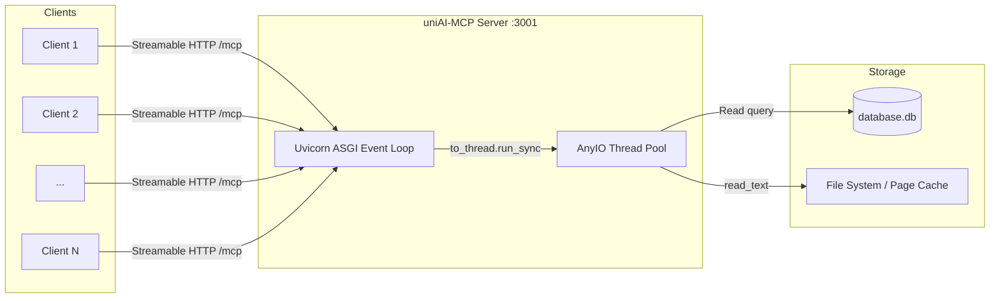

# Concurrent Load Testing Plan for uniAI-MCP

## Overview

This document details the strategy, tooling, test scenarios, and execution plan for evaluating the concurrent performance, latency, and scalability of the **uniAI-MCP** server.

---

## 1. System Architecture Under Load

When clients send concurrent requests to uniAI-MCP:

1. **Uvicorn / Starlette Event Loop**: Accepts concurrent HTTP connections on port `3001` (`/mcp` endpoint) non-blockingly.
2. **AnyIO Thread Pool**: Because tool functions (`get_syllabus`, `get_notes`, `get_pyq`, `get_availability`) are defined as synchronous `def` functions, the MCP framework offloads each call via `anyio.to_thread.run_sync` to a background worker thread (default maximum: 40 threads).
3. **Database Layer**: Each worker thread opens an isolated `sqlite3.connect(DB_PATH)` connection, executes a read-only `SELECT` query, and closes it.
4. **File System Layer**: The worker thread reads the target markdown resource(s) from `RESOURCES_ROOT` into memory and returns the response string.



---

## 2. Key Objectives & Metrics

The load testing framework aims to answer:

1. **Baseline Concurrency (5 concurrent requests)**: Verify that 5 simultaneous requests experience near-zero latency degradation and 0% errors.
2. **Scalability & Saturation (10, 25, 50, 100 concurrent requests)**:
   - Identify where throughput (Requests Per Second) plateaus.
   - Detect queuing delay when concurrency exceeds the default AnyIO thread pool limit (40 worker threads).
3. **Latency Profile**:
   - Record **Min**, **Median (p50)**, **p90**, **p95**, **p99**, and **Max** response times.
4. **Database & I/O Contention**:
   - Test whether concurrent SQLite reads experience locking or overhead.
   - Measure the impact of heavy I/O operations (`get_pyq` reading and concatenating 34 markdown files) versus light operations (`get_availability`).
5. **WAL Mode vs. Rollback Journal**:
   - Compare performance between current default journal mode (`delete`) and Write-Ahead Logging (`WAL`).

---

## 3. Workload Profiles & Test Scenarios

| Scenario | Tool Under Test | Operations Per Request | Expected Latency Profile |
| :--- | :--- | :--- | :--- |
| **A. Metadata Query** | `get_availability` | 1 SQLite query (aggregations), 0 file reads | Very Fast (< 10 ms) |
| **B. Single Document** | `get_syllabus` / `get_notes` | 1 SQLite query + 1 file read (5–35 KB) | Fast (< 20 ms) |
| **C. Heavy Aggregation** | `get_pyq` | 1 SQLite query + 34 file reads (~196 KB total) | Moderate (30–80 ms) |
| **D. Realistic Mixed** | 20% Availability, 30% Syllabus, 35% Notes, 15% PYQ | Mixed distribution mimicking real AI agent workflows | Realistic Blend |

---

## 4. Test Execution Tiers

Each scenario will be evaluated across the following concurrency levels:

* **Tier 1 (Baseline)**: Concurrency = 5, Requests = 100
* **Tier 2 (Moderate)**: Concurrency = 10, Requests = 250
* **Tier 3 (High)**: Concurrency = 25, Requests = 500
* **Tier 4 (Saturation / Thread Pool Capacity)**: Concurrency = 50, Requests = 1,000
* **Tier 5 (Overload / Queue Stress)**: Concurrency = 100, Requests = 1,000

---

## 5. Tooling & Implementation Design

### 5.1 Test Client (`scripts/load_test.py`)
A standalone, asynchronous load generator built using Python standard library `asyncio` and `httpx` (already in the project venv).

* **Command**:
  ```bash
  uv run python scripts/load_test.py --concurrency 5 --requests 100 --scenario mixed
  ```
* **Parameters**:
  - `--url`: MCP endpoint URL (default: `http://127.0.0.1:3001/mcp`)
  - `--host-header`: Host header to pass DNS rebinding checks (default: `uniai-mcp.git-pratap-shrey.online`)
  - `--concurrency`: Number of parallel worker tasks (`-c`)
  - `--requests`: Total number of requests to issue (`-n`)
  - `--scenario`: One of `availability`, `syllabus`, `notes`, `pyq`, or `mixed`
  - `--warmup`: Number of unmeasured warmup requests (default: 10)
  - `--json`: Output raw JSON metrics for automated reporting
* **Output Format**:
  Markdown summary table including:
  - Throughput (RPS)
  - Success / Failure counts and error rate %
  - Latency percentiles: min, p50, p90, p95, p99, max

### 5.2 Automated Benchmark Runner (`scripts/run_load_suite.sh`)
An orchestration script that:
1. Detects or launches the uniAI-MCP server.
2. Iterates through all test tiers (5, 10, 25, 50, 100 concurrency).
3. Executes baseline vs. WAL mode comparison.
4. Generates a consolidated markdown report in `benchmark_results.md`.

---

## 6. Verification and Success Criteria

- **0% Error Rate**: No HTTP 5xx errors, timeouts, or SQLite connection crashes up to 50 concurrent requests.
- **Low Latency**: Median latency (p50) remains under 30 ms for single-file and metadata tools.
- **Graceful Queuing**: At 100 concurrency (exceeding the 40-thread pool), requests queue and complete without dropped connections.
- **Reproducible Suite**: Any developer can run the benchmark via a single command:
  ```bash
  bash scripts/run_load_suite.sh
  ```
